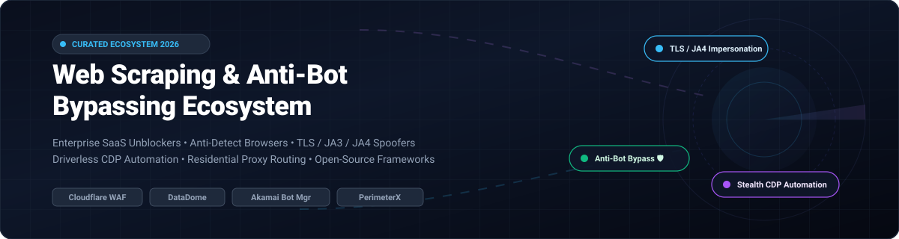

# 🌐 Awesome Web Scraping & Anti-Bot Bypassing 🛡️

<p align="center">
  
</p>

<p align="center">
  <a href="https://github.com/ishandutta2007/Awesome-Awesome-Awesome"></a><a href="https://discord.gg/jc4xtF58Ve"></a>
  <a href="https://github.com/ishandutta2007/Awesome-Web-Scraping-Anti-Bot-Bypassing/stargazers"></a>
  <a href="https://github.com/ishandutta2007/Awesome-Web-Scraping-Anti-Bot-Bypassing/network/members"></a>
  <a href="https://github.com/ishandutta2007/Awesome-Web-Scraping-Anti-Bot-Bypassing/blob/main/LICENSE"></a>
  <a href="https://github.com/ishandutta2007/Awesome-Web-Scraping-Anti-Bot-Bypassing/pulls"></a>
  <a href="https://github.com/ishandutta2007"></a>
</p>

---

## ⚡ Quick Navigation 🧭

- [📖 Overview & Key Features](#-overview--key-features-)
- [📊 Sector Overview & Market Dynamics](#-sector-overview--market-dynamics-)
- [🏢 SaaS & Hosted Web Unblocking Platforms](#-saas--hosted-web-unblocking-platforms-)
- [🔓 Open-Source Anti-Detect & Scraping Tools](#-open-source-anti-detect--scraping-tools-)
- [🛠️ Architectural Cheat Sheet: Defense vs Bypass](#-architectural-cheat-sheet-defense-vs-bypass-)
- [⭐ Star History](#-star-history-)
- [💖 Support & Sponsorship](#-support--sponsorship-)
- [🤝 How to Contribute](#-how-to-contribute-)
- [⚖️ Disclaimer](#-disclaimer-)

---

## 📖 Overview & Key Features 🚀

Welcome to the definitive curated directory of **Web Scraping, Anti-Bot Bypassing, and Headless Browser Automation** ecosystems. In modern web data extraction, standard HTTP scrapers face sophisticated Bot Management Systems (BMS) and Web Application Firewalls (WAF) such as **Cloudflare Turnstile & Bot Management**, **Akamai Bot Manager**, **DataDome**, **Kasada**, **PerimeterX (HUMAN Security)**, and **AWS WAF**.

This repository tracks:
- 🕵️ **Stealth Browser Automation**: Driverless CDP tools, patched Playwright/Puppeteer runtimes, and anti-detect Firefox/Chromium engines.
- 🔒 **TLS / JA3 / JA4 & HTTP/2 Impersonation**: Replicating exact browser cipher suites, extension orders, and HTTP/2 settings to evade network-layer fingerprinting.
- 🎭 **Canvas / WebGL / Navigator Spoofing**: Eliminating `navigator.webdriver`, leaking CDP traits, and consistent font/audio rendering.
- 🌐 **Enterprise Proxy Networks**: Residential, mobile, and datacenter IP rotation pools with automated CAPTCHA challenge solvers.

---

## 📊 Sector Overview & Market Dynamics 📈

> **Estimated Market Size**: The global web scraping software and proxy data collection services market was estimated at **$1.0 – $1.2 billion in 2024** and is projected to expand at a CAGR of **13.5% to exceed $2.5 billion by 2030**, accelerated by LLM synthetic dataset training and real-time enterprise AI retrieval.
>
> **Market Fragmentation & Dynamics**: The industry is **moderately fragmented**; while tier-1 infrastructure providers (Bright Data, Oxylabs, Smartproxy) control the majority of residential IP routing capacity, rapid innovation in anti-bot defense algorithms creates continuous openings for agile unblocker APIs and open-source stealth runtimes rather than a strict winner-take-all monopoly.

---

## 🏢 SaaS & Hosted Web Unblocking Platforms ☁️

The following enterprise platforms offer managed proxy routing, headless rendering, and automated anti-bot unblocking. Sorted by **Estimated Revenue / Valuation (Descending)**:

| 🏢 Platform | 💰 Pricing (Starting Tier) | 🎁 Free Tier / Trial Limits | 📈 Scale (Revenue / Valuation) | 🛡️ Key Capabilities |
| :--- | :--- | :--- | :--- | :--- |
| **[Bright Data](https://brightdata.com)** 🌐 | **$500/month** (Micro-package) or Pay-as-you-go ($8.40/GB resi, $1.50/k browser requests) | **7-day free trial** with **$5 trial credit** for businesses | **~$350M+ Valuation** (~$120M+ ARR, acquired by EMK Capital) | Enterprise Web Unlocker, Scraping Browser, 72M+ residential IPs, CAPTCHA solver |
| **[Oxylabs](https://oxylabs.io)** ⚡ | **$49/month** (Starter Web Unblocker / Scraping API; Pay-as-you-go from $8/GB) | **7-day free trial** with **$10 trial credit** (or 5K requests) | **~$100M+ ARR** (bootstrapped tier-1 proxy & data extraction leader) | Web Unblocker AI, dynamic browser fingerprint generation, 100M+ proxy pool |
| **[Zyte](https://zyte.com)** 🧠 | **$29/month** (Starter Zyte API tier; Pay-as-you-go available) | **$5 free trial credit** valid for **30 days** | **~$50M+ ARR** (pioneers behind Scrapy and headless smart scraping) | AI-powered automatic extraction, smart IP rotation, transparent anti-bot unblocking |
| **[Decodo (Smartproxy)](https://decodo.com)** 🌍 | **$7/month** (Pay-as-you-go from $3.50/GB residential, $5/month scraping API) | **3-day free trial** with **100MB data limit** or **1,000 scraping requests** | **~$40M+ ARR** (recognized global proxy & unblocking network) | Residential/ISP proxy network, fast Scraping API, headless browser automation |
| **[Apify](https://apify.com)** 🐝 | **$49/month** (Starter tier for cloud actors & compute) | **Free Forever plan** with **$5 compute credit every month** | **~$20M+ ARR** (raised $3M+ Series A, fast-growing web automation cloud) | Cloud scraping marketplace with thousands of pre-built Actors and headless browser orchestration |
| **[ScraperAPI](https://scraperapi.com)** 🚀 | **$49/month** (Hobby plan with 100,000 API credits) | **7-day free trial** with **5,000 free API credits** | **~$15M+ ARR** (popular unblocking API among engineering teams) | Single REST endpoint for proxy rotation, headless JS rendering, and CAPTCHA bypass |
| **[Scrapfly](https://scrapfly.io)** 🛡️ | **$30/month** (Starter plan with 200,000 API credits) | **Free Forever plan** with **1,000 API credits/month** | **~$6M+ ARR** (fast-growing anti-bot bypass specialist) | Anti-Scraping Protection (ASP) bypass, residential proxy integration, built-in screenshot & LLM parsers |
| **[Browserbase](https://browserbase.com)** 🖥️ | **$20/month** (Developer plan with 1,000 browser session minutes) | **Free Forever tier** with **60 browser session minutes/month** | **~$50M Valuation** (raised $10M+ Series A led by Kleiner Perkins) | Serverless headless Chrome infrastructure with stealth unblocking, session replays, and captcha solver |
| **[ScrapingBee](https://scrapingbee.com)** 🐝 | **$49/month** (Freelance plan with 250,000 API credits) | **1,000 free API credits** (no time limit on trial usage) | **~$5M+ ARR** (profitable SaaS acquired by private group) | Stealth headless Chrome execution, structured AI/CSS extraction, automated proxy rotation |
| **[Crawlbase](https://crawlbase.com)** 🕷️ | **$29/month** (Crawl API Starter with 200,000 requests) | **Free Forever plan** with **1,000 free API requests** upon sign-up | **~$4M+ ARR** (formerly ProxyCrawl, established web crawler) | Smart Proxy & Crawling API engineered to evade rate limits and complex anti-scraping systems |
| **[WebScraping.AI](https://webscraping.ai)** 🤖 | **$19/month** (Starter tier with 100,000 API credits) | **Free Forever plan** with **2,000 API calls/month** | **~$1.5M+ ARR** (lean, boot-strapped AI web unblocker platform) | AI-powered extraction API bundling rotating proxies, JS rendering, and automatic question-answering |

---

## 🔓 Open-Source Anti-Detect & Scraping Tools 💻

The open-source community provides battle-tested stealth libraries, C++-level browser engines, and TLS impersonation clients. Sorted by **GitHub_Stars_Count (Descending)**:

| 📦 Repository & Project | ⭐ GitHub_Stars | 🏷️ Category | 📝 Description |
| :--- | :---: | :---: | :--- |
| **[Scrapling](https://github.com/D4Vinci/Scrapling)** | [](https://github.com/D4Vinci/Scrapling/stargazers) | Adaptive Stealth Scraper | High-performance Python framework with built-in `StealthyFetcher`, TLS fingerprint mimicry, and self-healing selectors. |
| **[Crawlee](https://github.com/apify/crawlee)** | [](https://github.com/apify/crawlee/stargazers) | Scraping & Crawling Engine | Full-featured TypeScript/Python scraping engine with session pools, fingerprint generation, and proxy rotation. |
| **[FlareSolverr](https://github.com/FlareSolverr/FlareSolverr)** | [](https://github.com/FlareSolverr/FlareSolverr/stargazers) | Proxy Challenge Solver | Self-hosted proxy server running stealth browsers to solve Cloudflare and DDoS-GUARD challenge interstitials. |
| **[Camoufox](https://github.com/daijro/camoufox)** | [](https://github.com/daijro/camoufox/stargazers) | Anti-Detect Browser | Open-source Firefox fork spoofing WebGL, Canvas, AudioContext, fonts, and OS internals at the C++ level. |
| **[SeleniumBase](https://github.com/seleniumbase/SeleniumBase)** | [](https://github.com/seleniumbase/SeleniumBase/stargazers) | Test & Bypass Automation | Comprehensive Python automation framework featuring Undetected-Chromedriver (UC) Mode and CDP Mode. |
| **[Undetected Chromedriver](https://github.com/ultrafunkamsterdam/undetected-chromedriver)** | [](https://github.com/ultrafunkamsterdam/undetected-chromedriver/stargazers) | Selenium Driver Patcher | Iconic driver patcher that strips `navigator.webdriver` flags and Selenium automation signatures automatically. |
| **[DrissionPage](https://github.com/g1879/DrissionPage)** | [](https://github.com/g1879/DrissionPage/stargazers) | Hybrid Browser / HTTP | Python library combining direct CDP control and `requests`-like network operations without Selenium overhead. |
| **[Puppeteer Extra](https://github.com/berstend/puppeteer-extra)** | [](https://github.com/berstend/puppeteer-extra/stargazers) | Automation Plugin Suite | Modular plugin framework featuring `puppeteer-extra-plugin-stealth` to mask headless Chrome leaks. |
| **[curl-impersonate](https://github.com/lwthiker/curl-impersonate)** | [](https://github.com/lwthiker/curl-impersonate/stargazers) | TLS/HTTP2 Impersonator | Custom C `curl` build compiled with BoringSSL to replicate real Chrome, Firefox, and Safari network handshakes. |
| **[curl_cffi](https://github.com/lexiforest/curl_cffi)** | [](https://github.com/lexiforest/curl_cffi/stargazers) | Python TLS/JA3 Client | Python CFFI wrapper for `curl-impersonate` enabling authentic browser TLS/JA3/JA4 and HTTP/2 requests. |
| **[Botasaurus](https://github.com/omkarcloud/botasaurus)** | [](https://github.com/omkarcloud/botasaurus/stargazers) | All-in-One Scraper | Python web scraping framework combining anti-detect browsing, human-like mouse simulation, and Cloudflare bypass. |
| **[Patchright](https://github.com/Kaliiiiiiiiii-Vinyzu/patchright)** | [](https://github.com/Kaliiiiiiiiii-Vinyzu/patchright/stargazers) | Patched Playwright | Open-source Playwright driver fork eliminating CDP `Runtime.enable` leaks and bot detection cues. |
| **[Browser Fingerprinting](https://github.com/niespodd/browser-fingerprinting)** | [](https://github.com/niespodd/browser-fingerprinting/stargazers) | Research & Test Suite | Definitive collection of browser fingerprinting tests, leaks, detection scripts, and bypass strategies. |
| **[Nodriver](https://github.com/ultrafunkamsterdam/nodriver)** | [](https://github.com/ultrafunkamsterdam/nodriver/stargazers) | Driverless CDP Automation | Next-generation asynchronous Python Chrome automation library operating directly over CDP without WebDriver. |
| **[Fingerprint Suite](https://github.com/apify/fingerprint-suite)** | [](https://github.com/apify/fingerprint-suite/stargazers) | Fingerprint Generation | Generates realistic browser fingerprints and injects them into Playwright and Puppeteer runtimes. |
| **[CloudflareBypassForScraping](https://github.com/sarperavci/CloudflareBypassForScraping)** | [](https://github.com/sarperavci/CloudflareBypassForScraping/stargazers) | Challenge Solver | Python utility tailored to solve Cloudflare Turnstile and interstitial verification challenges. |
| **[Byparr](https://github.com/ThePhaseless/Byparr)** | [](https://github.com/ThePhaseless/Byparr/stargazers) | Anti-Bot Proxy Server | High-performance FastAPI and Camoufox-powered drop-in replacement for FlareSolverr challenge solving. |
| **[tls-client](https://github.com/bogdanfinn/tls-client)** | [](https://github.com/bogdanfinn/tls-client/stargazers) | Go TLS Impersonator | Go HTTP library based on `utls` accurately mimicking browser TLS ClientHello fingerprints and HTTP/2 headers. |
| **[CycleTLS](https://github.com/Danny-Dasilva/CycleTLS)** | [](https://github.com/Danny-Dasilva/CycleTLS/stargazers) | JA3/JA4 Spoofing Client | Go and Node.js networking library designed to spoof arbitrary TLS/JA3 signatures and bypass WAF fingerprint blocks. |
| **[rnet](https://github.com/0x676e67/rnet)** | [](https://github.com/0x676e67/rnet/stargazers) | Rust TLS/HTTP2 Client | Blazing fast Rust & Python HTTP client with built-in TLS and HTTP/2 frame fingerprint impersonation. |
| **[Zendriver](https://github.com/cdpdriver/zendriver)** | [](https://github.com/cdpdriver/zendriver/stargazers) | Driverless Automation | Actively maintained fork of `nodriver` delivering async, driverless Chromium automation with stealth defaults. |
| **[Scrapy-Playwright](https://github.com/scrapy-plugins/scrapy-playwright)** | [](https://github.com/scrapy-plugins/scrapy-playwright/stargazers) | Scrapy Browser Plugin | Official Scrapy download handler integrating Playwright contexts for JS rendering and challenge bypass. |
| **[Rebrowser Patches](https://github.com/rebrowser/rebrowser-patches)** | [](https://github.com/rebrowser/rebrowser-patches/stargazers) | Runtime Leak Fixes | Targeted patches for Puppeteer and Playwright eliminating `Runtime.enable` detection and execution leaks. |
| **[Stealth.min.js](https://github.com/requireCool/stealth.min.js)** | [](https://github.com/requireCool/stealth.min.js/stargazers) | Client Injection Script | Standalone compiled evasions script injectible into any headless browser session to fool client-side checks. |
| **[Playwright-Stealth](https://github.com/AtuboDad/playwright_stealth)** | [](https://github.com/AtuboDad/playwright_stealth/stargazers) | Playwright Plugin | Lightweight Python module masking automated browser parameters and fingerprint markers in Playwright. |
| **[Selenium-Stealth](https://github.com/diprajpatra/selenium-stealth)** | [](https://github.com/diprajpatra/selenium-stealth/stargazers) | Selenium Evasions | Python package preventing Selenium Chromedriver detection by overriding navigator properties and vendor flags. |
| **[ImpIt](https://github.com/apify/impit)** | [](https://github.com/apify/impit/stargazers) | Rust HTTP Client | High-performance Rust HTTP client created by Apify to impersonate real browser TLS and HTTP/2 handshakes. |
| **[Primp](https://github.com/deedy5/primp)** | [](https://github.com/deedy5/primp/stargazers) | Rust/Python Client | Ultra-fast Python HTTP client written in Rust (BoringSSL) impersonating modern Chrome, Firefox, and Safari. |
| **[Scrapy-Impersonate](https://github.com/jxlil/scrapy-impersonate)** | [](https://github.com/jxlil/scrapy-impersonate/stargazers) | Scrapy Downloader | Custom Scrapy download handler wrapping `curl_cffi` so spiders bypass TLS fingerprint filters natively. |

---

## 🛠️ Architectural Cheat Sheet: Defense vs Bypass 🧩

```
       +-------------------------------------------------------------+
       |                  TARGET WEB APPLICATION                     |
       +-------------------------------------------------------------+
                                      ▲
                                      │
       +-------------------------------------------------------------+
       |             WAF / BOT MANAGEMENT DEFENSE LAYERS             |
       |  (Cloudflare, DataDome, Akamai, PerimeterX, Kasada, AWS WAF)|
       +-------------------------------------------------------------+
               ▲                              ▲
               │ Network & Transport          │ Browser & JavaScript
               │ Layer Detection              │ Layer Verification
               │                              │
     +---------------------+        +--------------------+
     |   TLS / JA4 / HTTP2 |        | Canvas, WebGL, CDP |
     |    Fingerprinting   |        |  Automation Flags  |
     +---------------------+        +--------------------+
               ▲                              ▲
               │                              │
     +---------------------+        +--------------------+
     | BYPASS: curl_cffi,  |        | BYPASS: Camoufox,  |
     | curl-impersonate,   |        | Nodriver, Patchright|
     | CycleTLS, rnet      |        | SeleniumBase UC    |
     +---------------------+        +--------------------+
               ▲                              ▲
               └──────────────┬───────────────┘
                              │
               +-----------------------------+
               |  MANAGED RESIDENTIAL PROXY  |
               | & RESILIENT SCRAPING STACK  |
               +-----------------------------+
```

---

## ⭐ Star History 📈

[](https://star-history.com/#ishandutta2007/Awesome-Web-Scraping-Anti-Bot-Bypassing&Date)

---

## 💖 Support & Sponsorship ☕

Thank you for visiting and supporting the **Awesome Web Scraping & Anti-Bot Bypassing** project! 🌟

If you found this ecosystem guide helpful or insightful:
- ⭐ **Star** this repository to help others discover it!
- 🍴 **Fork** and contribute new tools, libraries, or fixes.
- 📢 **Share** this list with colleagues, developer communities, and teams building scrapers.
- ☕ **Buy me a coffee**: If you'd like to support ongoing curation, research, and maintenance, consider sponsoring via the [GitHub Sponsors Dashboard](https://github.com/sponsors/ishandutta2007).

---

## 🤝 How to Contribute 💡

We welcome contributions to expand this directory! To add or update a tool:

1. 🍴 Fork the repository.
2. 🌿 Create a feature branch: `git checkout -b feature/add-new-tool`.
3. 📝 Add your tool to the appropriate section maintaining markdown table structure and accurate metadata.
4. 🚀 Open a Pull Request with a clear description and links.

---

## ⚖️ Disclaimer 📜

This curated repository is compiled for **educational, security research, and engineering analysis purposes only**. Web data extraction must adhere to applicable laws, terms of service of target websites, and responsible rate limiting practices. Always respect robots.txt and privacy guidelines.
